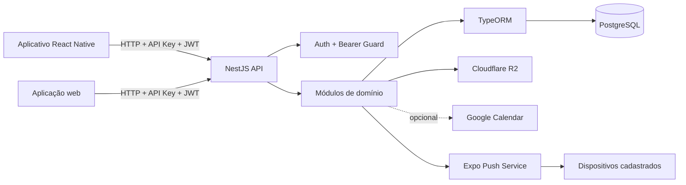
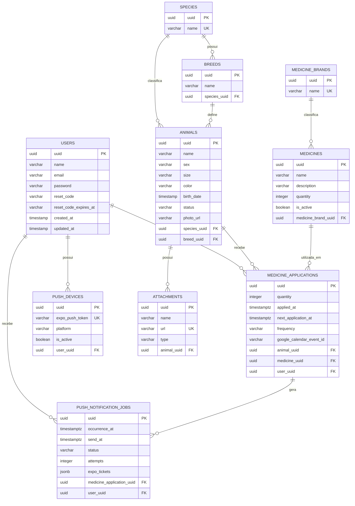
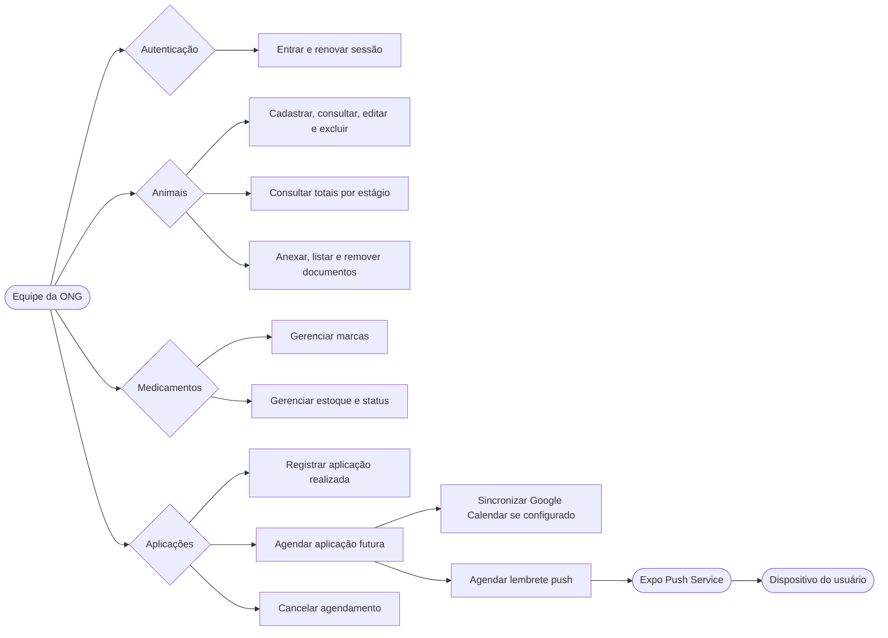
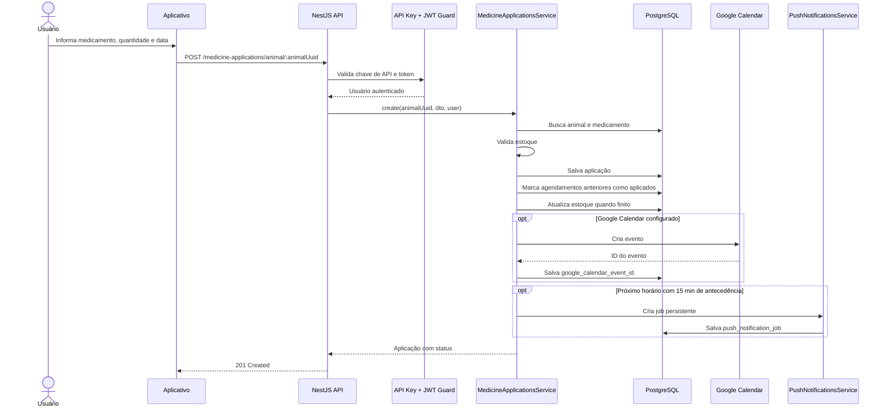
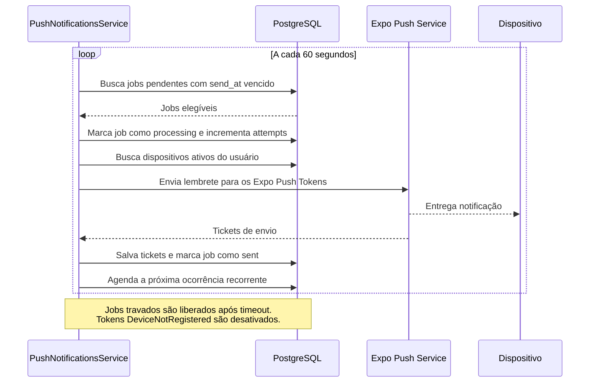
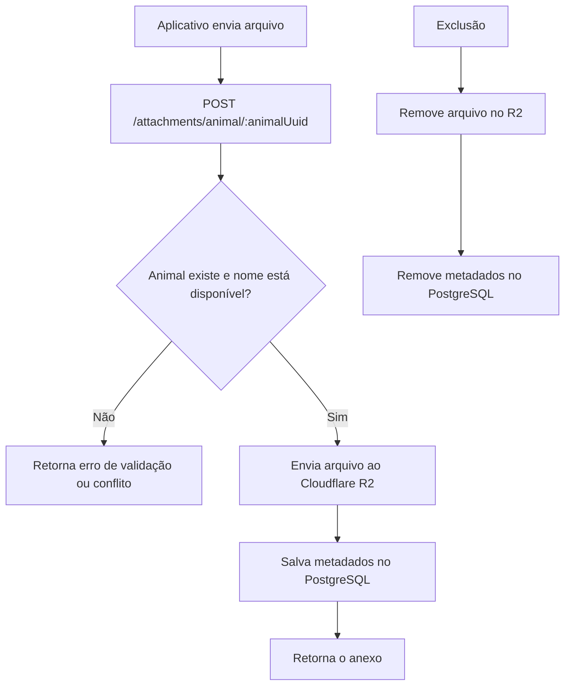

# Focinho Amigo 🐾

<p align="center">API de gerenciamento da ONG Focinho Amigo.</p>

<p align="center">
 <a href="#tecnologias">Tecnologias</a> •
 <a href="#descricao">Descrição</a> •
 <a href="#arquitetura">Arquitetura</a> •
 <a href="#diagramas">Diagramas</a> •
 <a href="#instalacao">Instalação</a> •
 <a href="#testes">Testes</a>
</p>

<a href="https://focinhoamigo.com.br" target="_blank">
  
</a>

## Tecnologias

| Área | Tecnologias |
| --- | --- |
| API | Node.js, TypeScript, NestJS e Express |
| Dados | PostgreSQL, TypeORM e migrations |
| Segurança | JWT, Passport, Argon2 e chave de API |
| Arquivos | Multer, AWS SDK e Cloudflare R2 |
| Agenda | Google Calendar API, Expo Push Service e date-fns |
| Qualidade | Jest, Supertest, Biome, Husky e Commitlint |
| Documentação | Swagger e Scalar em `/docs` |

## Descrição

O **Focinho Amigo** é um sistema para a ONG **Focinho Amigo**, de **Indaiatuba - SP**. A API concentra os dados dos animais assistidos, seus documentos, medicamentos e agendamentos.

- Autenticação com access token e refresh token JWT.
- Gestão de animais, espécies, raças e métricas por estágio.
- Upload, listagem e remoção de anexos no Cloudflare R2.
- Gestão de marcas, estoque e status de medicamentos.
- Registro de aplicações realizadas e agendamento de próximas aplicações.
- Atualização de estoque ao criar ou cancelar aplicações.
- Integração opcional com Google Calendar.
- Lembretes push persistentes, enviados 15 minutos antes da aplicação.

## Arquitetura



A chave de API é verificada globalmente, com exceção de `GET /health`; a guarda JWT protege as rotas privadas. As entradas são validadas por pipes com `whitelist`, `transform` e rejeição de campos desconhecidos.

## Organização

```text
src/
├── config/                    # Ambiente, banco e Swagger
├── guards/                    # Guarda Bearer JWT
├── lib/                       # Clientes Google Calendar e Cloudflare R2
├── middlewares/               # Chave de API
├── migrations/                # Histórico do banco
└── modules/
    ├── auth/                  # Login e renovação de tokens
    ├── users/                 # Usuários
    ├── animals/               # Animais e métricas
    ├── species/               # Espécies e raças
    ├── attachments/           # Anexos no R2
    ├── medicine-brands/       # Marcas
    ├── medicines/             # Estoque e status
    ├── medicine-applications/ # Histórico e agenda
    ├── push-notifications/    # Dispositivos e jobs de push
    ├── google-calendar/       # Contratos da agenda
    └── health/                # Health check
```

## Diagramas

### DER — modelo relacional

O DER reúne as tabelas de domínio e o processamento persistente de notificações. Campos de auditoria foram resumidos para favorecer a leitura.



### Casos de uso principais



### Sequência — agendamento de medicamento

O Google Calendar é opcional: sem suas variáveis de ambiente, a aplicação e o lembrete push continuam sendo persistidos.



### Sequência — entrega de notificação push



### Fluxo de anexos



## Endpoints principais

A documentação interativa está disponível em `http://localhost:3000/docs`.

| Área | Rotas |
| --- | --- |
| Autenticação | `POST /auth/sign-in`, `POST /auth/refresh-token` |
| Animais | CRUD em `/animals` e `GET /animals/total-per-stage` |
| Espécies e raças | CRUD em `/species` e rotas de `/species/:speciesUuid/breeds` |
| Anexos | `POST /attachments/animal/:animalUuid`, `GET /attachments/by-animal/:animalUuid`, `DELETE /attachments/:uuid` |
| Medicamentos | CRUD em `/medicine-brands` e `/medicines`; ativação/desativação em `/medicines/:uuid/activate` e `/deactivate` |
| Aplicações | `POST /medicine-applications/animal/:animalUuid`, `GET /medicine-applications/by-animal/:animalUuid`, `DELETE /medicine-applications/:uuid` |
| Push | `POST /push-notifications/devices`, `DELETE /push-notifications/devices` |

## Pré-requisitos

- Node.js 20 ou superior
- pnpm 11
- Docker e Docker Compose
- Credenciais opcionais do Google Calendar e Cloudflare R2 para usar essas integrações

O projeto declara `pnpm@11.7.0`. Caso necessário:

```bash
npm install -g pnpm
```

## Instalação

1. Clone o repositório:

   ```bash
   git clone https://github.com/victorozoterio/friendly-snout-back.git
   cd friendly-snout-back
   ```

2. Crie e preencha o ambiente:

   ```bash
   cp .env.example .env
   ```

   ```env
   NODE_ENV=development
   PORT=3000
   DB_NAME=friendly_snout
   DB_HOST=localhost
   DB_PORT=5432
   DB_USERNAME=postgres
   DB_PASSWORD=postgres
   X_API_KEY=sua-chave-de-api
   JWT_SECRET_KEY=seu-segredo-jwt
   ```

3. Instale as dependências e inicie o banco:

   ```bash
   pnpm install
   docker compose up -d
   ```

4. Execute as migrations e inicie a API:

   ```bash
   pnpm typeorm migration:run
   pnpm start:dev
   ```

## Testes

| Comando | Descrição |
| --- | --- |
| `pnpm test` | Executa testes unitários. |
| `pnpm test:watch` | Executa testes unitários em observação. |
| `pnpm test:coverage` | Gera a cobertura de testes unitários. |
| `pnpm test:e2e` | Executa testes E2E. |
| `pnpm build` | Compila a aplicação NestJS. |
| `pnpm format` | Executa o Biome com correções seguras. |

## Melhorias futuras

- [ ] Adicionar logs estruturados com Pino.
- [ ] Adicionar observabilidade com OpenTelemetry e Jaeger.
- [ ] Automatizar métricas e alertas do processador de notificações push.
